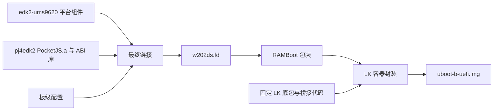

# W202DS Boot

W202DS 引导固件的组合层：保留当前使用的 LK 驻留/返回桥接源码，组合 `edk2-ums9620` 与 `pj4edk2` 的产物，生成完整 B 槽引导镜像和 ESP 加载器目录。

## 四个仓库如何配合

| 仓库 | 负责的功能 |
| --- | --- |
| `edk2-ums9620` | EDK II 核心、UMS9620 UEFI 驱动、LK 交接接口、Android/Linux EFI 加载器 |
| `pj4edk2` | 公共 ABI、PocketJS 引擎、UEFI 运行时、默认菜单/设置/恢复/充电页面 |
| `w202ds-boot` | LK 桥接、板级菜单配置、最终链接、RAMBoot 包装、5 MiB LK 容器封装、ESP 加载器布局 |
| `w202ds-linux` | Linux 内核、设备树、模块、硬件固件及 Linux 集成 |



运行时顺序为：LK 初始化底层硬件 → 桥接进入 EDK II → PocketJS 菜单 → EFI 加载 Linux 或返回 LK 启动 Android。EDK II 不链接 LK `.a`。

## 为什么还需要 LK 底包

底包是版本固定的 W202DS LK **二进制** `uboot-b-pjs-ram-v2.img`，不是另一个源码工程。本流程重编译 `lk/` 中的桥接/加载器，再补入该底包。完整上游 LK 源码来自 `sprd-linux/lk`，但目前没有经过验证、能从该完整源码树重建这个底包的流程。

因此这里保存实际使用的桥接源码及来源版本，不引入整棵未参与构建的 LK。二进制输入由调用者明确提供；名称、用途、尺寸和 SHA-256 见 [inputs.lock.json](inputs.lock.json)。底包哈希不匹配会拒绝封装。设置镜像用于保留末尾两份 PJB 设置区，需与相同底包兼容。

## 完整构建

三个仓库可并排放置，也可以通过参数指定位置。需要 Bash、Python 3.11+、GNU make、GCC/G++、UUID 开发头文件、AArch64 GNU GCC/binutils，以及 `pj4edk2` 声明的 Rust 工具链。子模块初始化和依赖版本见另外两个仓库的 README。

```sh
python3 build.py --output /path/to/build/w202ds \
  --lk-baseline /path/to/inputs/uboot-b-pjs-ram-v2.img \
  --settings-image /path/to/inputs/settings-source.img \
  --touch-firmware ../w202ds-linux/6.18.35/Devices/touchscreen/firmware/Himax_firmware_guoxian.bin
```

`--output` 必须是位于三个源码树外的新目录。`--edk2`、`--pocketjs` 可指定另外两个仓库；`--jobs` 控制并行度。构建先生成私有 BaseTools，再构建运行时、平台、最终 FD、桥接和 LK 容器，各阶段日志保存在输出的 `logs/`。

使用外部默认 UI 时加 `--default-ui /path/to/my-project/ui`，此目录遵循 `pj4edk2` 的 `ui.json`
格式。使用已有 `--rust-build` 或 `--runtime-build` 时也传入相同 UI，脚本会校验清单、JS 和字体
哈希，最终 `manifest.json` 记录实际 UI 输入。UI 文件不会被改写。

已有编译机产物时，使用 `--rust-build /path/to/received/rust`，本地无需 Rust。已有完整组件时，使用 `--runtime-build /path/to/build/pocketjs` 和/或 `--platform-build /path/to/build/platform`；提供的组件必须来自匹配的源码、配置和工具链。`EDK_TOOLS_PATH` 可以指向已编译的 BaseTools。

## 产物

| 输出 | 内容 |
| --- | --- |
| `w202ds.fd` | EDK II + PocketJS 最终固件卷，2 MiB |
| `ramboot.img` | 带校验描述符的 Android RAMBoot 包装 |
| `resident/uboot-b-uefi.img` | LK + 桥接 + RAMBoot，完整 5 MiB B 槽容器 |
| `ESP/EFI/Android/bootaa64.efi` | 返回 LK 启动 Android |
| `ESP/EFI/DebianServer/bootaa64.efi` | Server Linux 加载器 |
| `ESP/EFI/DebianKDE/bootaa64.efi` | KDE Linux 加载器 |
| `manifest.json`、`resident/manifest.json` | 输入与输出哈希、封装布局和验证状态 |

`ESP/` 是加载器增量目录；操作系统镜像和设备树仍由各系统提供，并不是一份完整 ESP 备份。构建入口只在主机生成文件。离线链接检查不能代替真机验证，迁移后的验证记录见 [VALIDATION.md](VALIDATION.md)。

## 底层工具

安装 Python `unicorn==2.1.4` 后，可对上述默认生产配置的构建运行现有 ARM64 测试：

```sh
PYTHONDONTWRITEBYTECODE=1 python3 test.py --build /path/to/build/w202ds
```

这会执行实际编译的 resident 和返回汇编，覆盖正常启动、原生模式保留、损坏/读取失败、显示/按键异常和返回上下文；MMIO、GIC 等硬件行为仍由测试模型提供。

`tools/edk2_sdk.py` 提供平台 SDK 导出、最终链接和验证；`tools/mkramboot.py` 检查 SEC 重定位并包装 FD；`lk/ramboot/package-resident.py` 检查底包、容量、不可变区域及设置区。`lk/ramboot/tests/` 保留 ARM64 Unicorn 桥接测试；所需输入通过测试中的环境变量显式提供。
