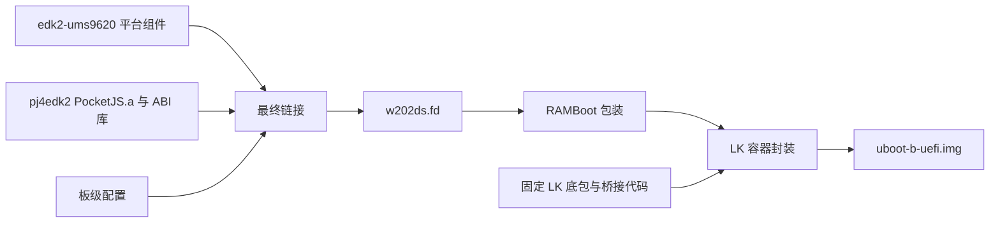

# PocketJS4EDK2 UEFI 组合层

本目录是 `w202ds-boot` 的组合构建项目：把 W202DS 的 EDK II 平台、PocketJS
运行时和 ESP 启动器组合成完整 B 槽引导镜像。仓库根目录只保留本项目与
`lk/`；`lk/` 存放 LK 侧桥接、原厂 LK 参考和后续板级 LK 材料，当前重组未改动
其中内容。

## 目录布局

```text
pocketjs4edk2_uefi/
├── build.py                 # 组合构建入口
├── config/                  # 板级 PocketJS 配置
├── components/              # 远端为 Git 子模块，本地同路径为链接
│   ├── edk2-ums9620 -> ../../../edk2-ums9620
│   └── pj4edk2 -> ../../../pj4edk2
├── efi/                     # 独立构建的 ESP 启动器与诊断应用
│   ├── Android/AndroidBoot/
│   ├── Android/AndroidLk/
│   ├── LinuxBoot/
│   ├── Diagnostics/HandoffProbe/
│   ├── Diagnostics/TouchScope/
│   ├── PocketJsUefiPkg.dsc
│   └── build-efi.sh
├── tests/                   # 组合层与 EFI 源码测试
├── tools/                   # SDK 导出、最终链接、RAMBoot 工具
├── inputs.lock.json         # LK 底包、设置区、触控固件哈希
├── test.py                  # 针对完整构建的 ARM64 Unicorn 测试
├── ui -> ../../pj4edk2/default-ui        # 可选默认 UI 链接
├── lk -> ../lk                          # 当前板级 LK 桥接
└── build/                   # 本地构建输出（忽略）
```

`w202ds-boot` 根目录的 `lk/` 不属于本 Python 项目，仍由 `build.py` 通过
`../lk` 使用；没有这个链接时回退到仓库根的 `lk/`。

## 四个仓库如何配合

| 仓库 | 负责的功能 |
| --- | --- |
| [`edk2-ums9620`](https://github.com/Yeamika/edk2-ums9620) | EDK II 核心、UMS9620 UEFI 驱动、LK 交接接口、平台 FV |
| [`pj4edk2`](https://github.com/Yeamika/pj4edk2) | 公共 ABI、PocketJS 引擎、UEFI 运行时、默认菜单/设置/恢复/充电页面 |
| [`w202ds-boot`](https://github.com/Yeamika/w202ds-boot) | LK 桥接、组合构建、最终链接、RAMBoot 包装、5 MiB LK 容器封装、ESP 布局 |
| `w202ds-linux` | Linux 内核、设备树、模块、硬件固件及 Linux 集成 |

`edk2-ums9620` 与 `pj4edk2` 在 `components/` 下登记为 Git 子模块，URL
指向 GitHub，父仓库记录固定提交。远端克隆使用真实子模块；本地开发在**同一
路径**使用指向并排仓库的符号链接，不额外建立组件副本。构建清单记录实际
读取的源码提交与文件哈希。`w202ds-linux` 由外部提供。



运行时顺序为：LK 初始化底层硬件 → 桥接进入 EDK II → PocketJS 菜单 → EFI
加载 Linux 或返回 LK 启动 Android。EDK II 不链接 LK `.a`。

## 子模块与本地链接

远端用户按 `components/` 下的子模块检出固定版本：

```sh
git clone --recursive https://github.com/Yeamika/w202ds-boot.git
```

已经 clone 但没初始化子模块时：

```sh
git submodule update --init
```

本地已有并排 checkout 时，无需下载。在尚未初始化组件子模块的
`w202ds-boot` 根目录执行：

```sh
mkdir -p pocketjs4edk2_uefi/components
# 全新 clone 可能留下空的子模块目录，先用 rmdir 移除；不要删除有内容的目录。
rmdir pocketjs4edk2_uefi/components/edk2-ums9620 pocketjs4edk2_uefi/components/pj4edk2
ln -s ../../../edk2-ums9620 pocketjs4edk2_uefi/components/edk2-ums9620
ln -s ../../../pj4edk2 pocketjs4edk2_uefi/components/pj4edk2
git update-index --skip-worktree pocketjs4edk2_uefi/components/edk2-ums9620 pocketjs4edk2_uefi/components/pj4edk2
ln -s ../../pj4edk2/default-ui pocketjs4edk2_uefi/ui
```

若子模块已初始化，先确认两个 checkout 没有未提交修改，再执行
`git submodule deinit -- pocketjs4edk2_uefi/components/edk2-ums9620 pocketjs4edk2_uefi/components/pj4edk2`，
然后替换清空的目录。`skip-worktree` 仅保存在本机索引，避免 `git add -A`
把链接替换成模式 `120000`；仓库记录仍须为 `160000`，可用
`git ls-files --stage pocketjs4edk2_uefi/components` 核对。

本地链接模式下不要执行 `git submodule update`。切回真实子模块时，先对两个
路径执行 `git update-index --no-skip-worktree`，用 `unlink` 移除这两个链接，
再执行 `git submodule update --init`。更新固定提交时需显式更新 gitlink；链接
目标的 HEAD 不会自动改变父仓库记录的提交。

`build.py` 优先使用 `components/<name>`（链接或真实子模块均可），兼容旧布局
链接，最后回退到 `pushup/<name>` 并排 checkout。`--edk2`、`--pocketjs` 始终可
显式选择其他仓库。`ui` 和 `lk` 本地链接由 `.gitignore` 忽略。

组件仓库内部的 `edk2`/`edk2-libc` 子模块只在单独构建组件时需要；组合构建会按
锁文件自动获取这些上游。

## ESP 源码

`efi/` 是实体源码目录，不再依赖 `edk2-ums9620` 的 `Ums9620Pkg/Applications`。
`efi/PocketJsUefiPkg.dsc` 独立编译以下应用：

- `Android/AndroidBoot/AndroidBoot.efi`
- `Android/AndroidLk/AndroidLk.efi`
- `LinuxBoot/DebianServer.efi`
- `LinuxBoot/DebianKde.efi`
- `Diagnostics/HandoffProbe/HandoffProbe.efi`
- `Diagnostics/TouchScope/TouchScope.efi`

`build.py` 在平台构建后调用 `efi/build-efi.sh`，将产物放入
`<output>/efi/bin/`，再把全部六个应用复制到 ESP。平台 DSC/FDF 不再包含这些
应用，只生成平台 FV。

## 完整构建

需要 Bash、Python 3.11+、GNU make、GCC/G++、UUID 开发头文件、AArch64 GNU
GCC/binutils，以及 `pj4edk2` 声明的 Rust 工具链。两个组件仓库各自获取上游
依赖，版本见各自 README。

在 `w202ds-boot` 根目录执行：

```sh
python3 pocketjs4edk2_uefi/build.py --output /path/to/build/w202ds \
  --lk-baseline /path/to/inputs/uboot-b-pjs-ram-v2.img \
  --settings-image /path/to/inputs/settings-source.img \
  --touch-firmware ../w202ds-linux/6.18.35/Devices/touchscreen/firmware/Himax_firmware_guoxian.bin
```

也可以 `cd pocketjs4edk2_uefi` 后使用同样的参数运行 `python3 build.py ...`。

`--output` 必须是位于本仓库、两个组件仓库和 UI 目录之外的新目录。`--edk2`、
`--pocketjs` 可指定另外两个仓库；`--jobs` 控制并行度。构建先生成私有
BaseTools，再构建运行时、平台、ESP 加载器、最终 FD、桥接和 LK 容器，各阶段
日志保存在输出的 `logs/`。输出目录会包含：

- `platform/workspace/Build/Ums9620/RELEASE_GCC5/FV/` — 平台 FV；
- `efi/bin/` — 本次编译的六个 EFI；
- `link-sdk/`、`w202ds.fd`、`ramboot.img`；
- `resident/uboot-b-uefi.img`；
- `ESP/EFI/{Android,DebianServer,DebianKDE}/bootaa64.efi`；
- `ESP/EFI/Tools/{AndroidBoot,HandoffProbe,TouchScope}.efi`；
- `efi/efi-build.json` — EFI 源码、公共 ABI、构建模式和二进制哈希；
- `manifest.json` — 源码提交、输入与产物哈希。

使用外部默认 UI 时加 `--default-ui /path/to/my-project/ui`，此目录遵循
`pj4edk2` 的 `ui.json` 格式。默认使用本目录的 `ui` 链接（若存在），否则使用
`pj4edk2/default-ui`。使用已有 `--rust-build` 或 `--runtime-build` 时也传入
相同 UI，脚本会校验清单、JS 和字体哈希，最终 `manifest.json` 记录实际 UI
输入。UI 文件不会被改写。

构建会通过 `edk2-ums9620` 获取 EDK II 和两份 Brotli，通过 `pj4edk2` 获取
`edk2-libc`、PocketJS、QuickJS-NG，默认使用两个项目各自声明的固定提交。
可以重复传入 `--source-ref edk2=指定提交`、`--source-ref pocketjs=latest`、
`--source-ref quickjs=完整提交或分支或标签`，以及 `--source-repo NAME=URL`
选择自己的 fork。`NAME` 支持 `edk2`、`brotli`、`edk2-libc`、`pocketjs`、
`quickjs`，也支持平台清单中的两个完整 Brotli 子模块路径。`--source-cache DIR`
可复用下载。

`pj4edk2` 可独立使用通用 EDK II。本组合工程通过 `--edk2` 向它传入 W202DS
平台实际使用的 EDK II checkout，并核对运行时 ABI 库、平台源码和
`platform-build.json` 中的 EDK II 提交一致；平台清单还核对两个 Brotli 的实际
仓库和提交。平台版本选择和兼容性检查属于本工程。

每次构建先解析一次上游，将实际提交写入 `upstream.lock.json`，再传给各阶段。
`--source-lock FILE` 可重放之前的清单；使用编译机产物时应指向该 Rust bundle 的
`upstream.lock.json`，并一并传回 `Cargo.lock`。完整用法见
[pj4edk2 上游源码说明](https://github.com/Yeamika/pj4edk2/blob/uefi/docs/upstream-sources.md)。

已有编译机产物时，使用 `--rust-build /path/to/received/rust`，本地无需 Rust。
已有完整组件时，使用 `--runtime-build /path/to/build/pocketjs` 和/或
`--platform-build /path/to/build/platform`；提供的组件必须来自匹配的源码、配置
和工具链。`EDK_TOOLS_PATH` 可以指向已编译的 BaseTools。

单独验证 ESP 编译阶段：

```sh
bash pocketjs4edk2_uefi/efi/build-efi.sh \
  --output /path/to/fresh/efi-build \
  --edk2 /path/to/edk2-ums9620/edk2 \
  --platform /path/to/edk2-ums9620 \
  --abi-include /path/to/pj4edk2/pocketjsforedk2/include \
  --tools /path/to/basetools
```

`--edk2` 必须是已初始化的上游 EDK II 树；`--platform` 是包含
`Ums9620Pkg/` 的平台仓库。

## 产物

| 输出 | 内容 |
| --- | --- |
| `w202ds.fd` | EDK II + PocketJS 最终固件卷，2 MiB |
| `ramboot.img` | 带校验描述符的 Android RAMBoot 包装 |
| `resident/uboot-b-uefi.img` | LK + 桥接 + RAMBoot，完整 5 MiB B 槽容器 |
| `ESP/EFI/Android/bootaa64.efi` | 返回 LK 启动 Android |
| `ESP/EFI/DebianServer/bootaa64.efi` | Server Linux 加载器 |
| `ESP/EFI/DebianKDE/bootaa64.efi` | KDE Linux 加载器 |
| `ESP/EFI/Tools/*.efi` | 直接 Android 实验、交接探针、触控诊断；菜单触控项指向此处 |
| `efi/bin/*.efi`、`efi/efi-build.json` | 六个独立应用与其源码/ABI/产物清单 |
| `manifest.json`、`resident/manifest.json` | 输入与输出哈希、封装布局和验证状态 |

`ESP/` 是加载器增量目录；操作系统镜像和设备树仍由各系统提供，并不是一份
完整 ESP 备份。构建入口只在主机生成文件。离线链接检查不能代替真机验证，
迁移后的验证记录见 [VALIDATION.md](VALIDATION.md)。

## 为什么还需要 LK 底包

底包是版本固定的 W202DS LK **二进制** `uboot-b-pjs-ram-v2.img`，不是另一个
源码工程。本流程重编译 `lk/ramboot` 中的桥接/加载器，再补入该底包。完整上游
LK 源码来自 `sprd-linux/lk`，但目前没有经过验证、能从该完整源码树重建这个
底包的流程。

因此 `w202ds-boot/lk` 保存实际使用的桥接源码、原厂 LK 参考和后续要接入的
板级 LK 代码；本组合项目只通过 `lk` 链接使用其中的 `ramboot`。二进制输入由
调用者明确提供；名称、用途、尺寸和 SHA-256 见
[inputs.lock.json](inputs.lock.json)。底包哈希不匹配会拒绝封装。设置镜像用于
保留末尾两份 PJB 设置区，需与相同底包兼容。

## 底层工具

安装 Python `unicorn==2.1.4` 后，可对上述默认生产配置的构建运行现有 ARM64
测试：

```sh
PYTHONDONTWRITEBYTECODE=1 python3 test.py --build /path/to/build/w202ds
```

这会执行实际编译的 resident 和返回汇编，覆盖正常启动、原生模式保留、损坏/
读取失败、显示/按键异常和返回上下文；MMIO、GIC 等硬件行为仍由测试模型提供。

`tools/edk2_sdk.py` 提供平台 SDK 导出、最终链接和验证；`tools/mkramboot.py`
检查 SEC 重定位并包装 FD；`lk/ramboot/package-resident.py` 检查底包、容量、
不可变区域及设置区。`lk/ramboot/tests/` 保留 ARM64 Unicorn 桥接测试；所需输入
通过测试中的环境变量显式提供。

## 迁移后的离线验收

所有测试产物应放在源码树之外。设置 `PJB_EDK2_ROOT` 指向已初始化的上游
EDK II（不是平台仓库）；`W202_TEST_OUTPUT` 和 `TMPDIR` 指向自己的临时输出目录。

```sh
python3 -m unittest discover -s pocketjs4edk2_uefi/tests -p test_abi_sources.py -v
python3 -m unittest discover -s pocketjs4edk2_uefi/tests -p test_efi_host.py -v
```

真实镜像解析测试还需显式提供 `W202_TEST_BOOT`（Android boot_a）、
`W202_TEST_VENDOR_BOOT`（vendor_boot_a）和 `W202_LINUX_BOOT`（历史已验证 Server
启动包），再分别运行 `test_android_boot.py`、`test_linux_boot.py`。
这些回归测试检查特定捕获输入，不能替代其他版本镜像兼容性或设备验收。

`AndroidLk` 直接使用平台的 `Ums9620Pkg/Include/LkReturn.h`，与 LK 桥接共用
同一份 ABI。独立 EFI 构建支持 `W202_ANDROID_BOOT_ENTER=TRUE`（直接 Android
实验）和 `W202_LK_RETURN_PROBE_ONLY=TRUE`（仅恢复 LK 探针）；默认均为 FALSE。
迁移后不再通过平台宏把应用嵌入 FV，旧的直接启动宏会在平台构建时明确拒绝。

全新克隆的验证必须使用真实 `components/` 子模块且不依赖 `ui`/`lk` 本地链接。
发布时先推送组件所需提交，再推父仓库；仅在本地通过验证不代表远端已发布。
